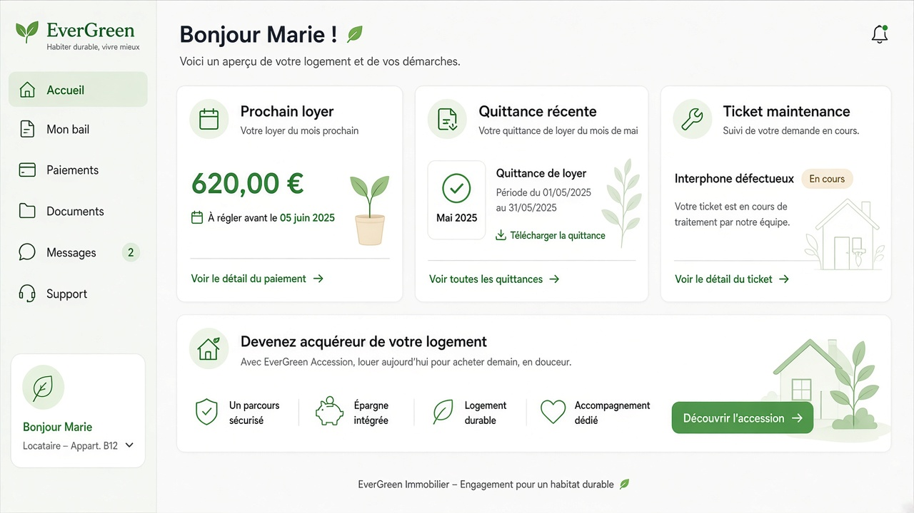

# Persona — Client (`client`)

**Mission :** prospect→candidat→locataire — Vague **V3**.  
**Shell :** `/espace/client`  
**Sprints :** `S08` → `S10`

## États portail

| Phase | Assignment | Voit |
| --- | --- | --- |
| Avant compte | — | rien (prospect CRM seulement) |
| **Candidat** | `candidate` | Mes candidatures · dépôt docs (+ disclaimer staff-only) |
| **Locataire** | `tenant` (après accept) | Portail débloqué : loyers · quittances · panne |

## Dashboard

Widgets locataire **uniquement** après `tenant`. Avant : focus candidatures.

## Frames S08

| Frame | Path |
| --- | --- |
| Demande visite | [`../../forms/demande-visite/`](../../forms/demande-visite/) |
| Dépôt docs | [`../../forms/candidature-location/`](../../forms/candidature-location/) |
| Mes candidatures | [`../../pages/espace/client/mes-candidatures/`](../../pages/espace/client/mes-candidatures/) |

## Reports ❌
