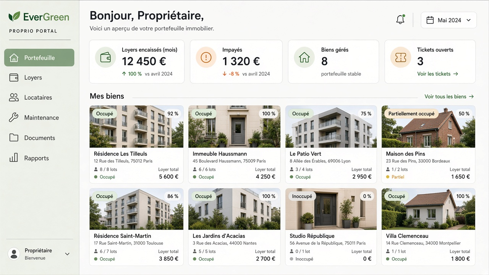
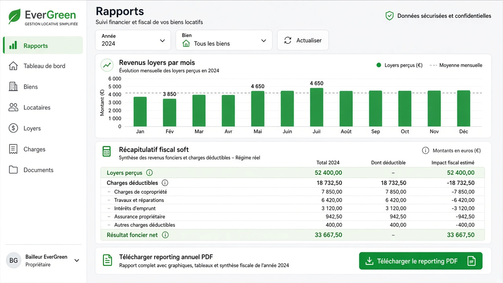

# Persona — Propriétaire / bailleur (`landlord`)

**Mission :** suivre biens gérés, **statut** candidatures, loyers — Vague **V3**.  
**Shell :** `/espace/proprio`  
**Sprints :** `S08` → `S10`

## Règle vault (S08)

Le propriétaire **ne voit jamais** les fichiers uploadés par les candidats (CNI, fiches de paie…).  
Il voit : statut, % complétude, synthèse agent. La revue des pièces = **personnel EverGreen**.

## Dashboard

**Widgets :** loyers · impayés · biens · candidatures (compteur / statuts) · tickets.

## Nav

Portefeuille · **Candidatures** · Locataires · Loyers · Maintenance · Documents · Rapports

## Frames S08

| Frame | Path | Docs fichiers ? |
| --- | --- | :---: |
| Inbox | [`../../pages/espace/proprio/candidatures/`](../../pages/espace/proprio/candidatures/) | ○ |
| Détail | [`../../pages/espace/proprio/candidature-detail/`](../../pages/espace/proprio/candidature-detail/) | ○ |

## Reports ✅

